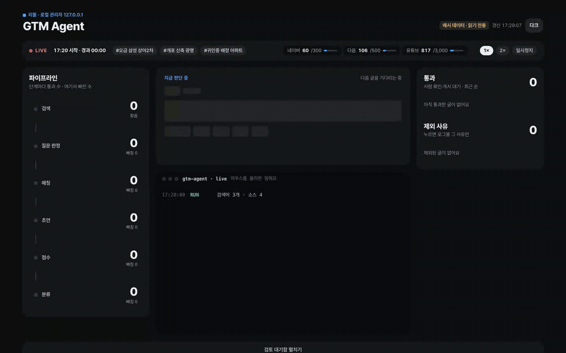
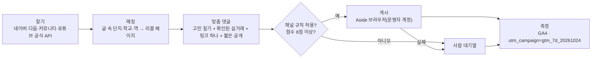

# REEVL GTM Agent

부동산 질문을 실제 데이터로 연결하는 Growth Loop

**광고를 뿌리는 대신, 사람들이 이미 묻고 있는 부동산 질문에 데이터로 답합니다.**

[Clone Loop Day in Seoul](https://luma.com/a1bags64) (2026-10-24, NAVER D2SF · Agentic GTM) 출품작, https://reevl.co.kr

### Summary

| | |
|---|---|
| Repo | https://github.com/exclusiveyon-a11y/reevl-gtm-loop |
| Loop | 네이버 카페·지식iN·당근·유튜브 등 국내 부동산 커뮤니티에서 실제 주거 고민 탐지 → 질문 속 단지·학교·역을 추출해 리블 실거래 데이터와 매칭(D1부터 Claude로 예산·조건까지 추출) → 근거 있는 2~3줄 답변 + 맞춤 비교 딥링크(두 단지 미리보기 카드 포함) → 정확성·커뮤니티 규칙 검수 후 허용된 방식으로 게시(Day 0 규칙 점수·코드 검증, D1부터 Claude 판정) → GA4로 유입·참여·재방문 측정 → 매일 성과 높은 질문 유형·채널에 집중 |
| 차별점 | 광고성 댓글이 아닌 실제 질문에 대한 데이터 기반 답변. 기존 네이버 카페에서 자발적으로 확산된 단지 비교 링크가 참여율 89%, 세션당 7페이지를 기록한 것을 재현·확장하는 루프 |
| 오늘 실측 | 커뮤니티 콘텐츠 365건 발견 → 유효 질문 12건 선별 (초기 비용 0원) |
| 7-day goals (~10/31 18:00) | 네이버 외부 유입 주 66명 → 500명+ / Agent 추적 착지 100세션+ / 참여율 85%+ / 세션당 5페이지+ / 재방문율 3.8% → 6% / 추가 사람 검수 필요 비율 20% 이하 / 정책 위반·삭제 0건 |

### Product

**리블(Reevl)은 전국 부동산 실거래 데이터를 자체 AI 예측 모델과 자연어 기반 공간검색 기술로 연결해, 사용자에게 최적의 부동산을 찾고 비교하도록 돕는 AI 부동산 탐색 플랫폼입니다.**

전국 약 4.6만 개 아파트 단지와 12개 부동산 유형의 실거래·입지 정보를 무료로 제공합니다.
전국 실거래가, 학군, 교통, 전세가율, 거래량 등을 연결하고, 자체 AI 기반 가격 전망·수요강도 분석과 단지 비교·조건별 스크리너를 제공합니다.

### Our Agentic Loop

**Discover → Match → Answer → Review → Measure → Improve**

1. **Discover:** 네이버 카페·지식iN·유튜브·국내 부동산 커뮤니티에서 실제 주거 질문 탐지. 공식 API만 사용(`agent/discover.py`)
2. **Match:** 질문에 등장하는 단지·학교·역·지역을 리블 데이터와 자동 매칭(`agent/match.py`, `agent/hubs.py`)
3. **Answer:** 검증된 실거래 데이터로 답하는 2~3줄 요약과 맞춤 비교·분석 딥링크 생성(`agent/intent.py`, `agent/reply.py`)
4. **Review:** Claude Haiku로 질문·적절성 판정, Sonnet으로 단지·지역·평형 추출과 답변 작성, Haiku 심사(애매하면 Opus 재심)와 숫자 코드 대조. 게시 정책에 맞춰 검수·발행하고 리블과의 관계 공개([설계·예산](docs/06-claude-plan.md))
5. **Measure & Improve:** GA4로 유입·참여·재방문을 추적하고 매일 성과에 따라 다음 질문 선정과 답변 방식 개선(`analysis/ga_report.py`, [실험 로그](docs/07-loop-log.md))

**차별점:** 기존 GTM Agent가 잠재고객에게 메시지를 보내는 방식이라면, 리블은 이미 존재하는 부동산 질문을 실제 데이터와 연결해 '공유 가능한 답변'으로 바꿉니다.

### Day 0 Initial Validation

- 커뮤니티 콘텐츠 **365건 탐지** (네이버 카페·지식iN·다음 카페·디시·블라인드·클리앙·에펨·뽐뿌·엠팍·더쿠, 유튜브 별도 시험)
- 질문 적합성·데이터 매칭·스코어링 통과 **12건**
- 초기 탐지 비용 **0원**
- 기존 리블 비교 공유 링크 실측: **참여율 89%, 세션당 7.0페이지** (최근 30일, GA4)

리블의 기존 사용자는 네이버 검색에 집중되어 있지만, 커뮤니티에서 자연스럽게 공유된 아파트 비교 링크는 높은 참여도를 보였습니다. 이 현상을 반복 가능한 GTM Loop로 확장하고 있습니다.

### 7-Day Goals (until Oct 31, 18:00 KST)

| Metric | Baseline | Target |
|---|---:|---:|
| Non-Naver acquisition | 66 users/week | **500+** |
| Agent-attributed landing sessions | 0 (new campaign) | **100+** |
| Landing engagement rate | 89% (existing comparison) | **85%+** |
| Pages per session | 7.0 (existing comparison) | **5.0+** |
| Returning user rate | 3.8% | **6%** |
| Cases requiring additional human review | 100% | **≤20%** |
| Policy violations / content removals | — | **0** |

AI 예산은 Claude 크레딧 $100(11/7 만료) 안에서 하루 $8 · 총 $98로 제한하며, 커뮤니티 정책과 게시 권한을 준수합니다. 매일의 발견·답변·배포·성과·개선 사항을 공개 로그에 기록합니다.

**우리가 검증하려는 가설은 단순합니다.**

> 사람들이 집을 고민하는 순간, 광고보다 검증 가능한 데이터와 바로 열리는 비교 결과를 제공하는 것이 더 효과적인 성장 방법일 수 있다.

**GitHub:** https://github.com/exclusiveyon-a11y/reevl-gtm-loop  
**Service:** https://reevl.co.kr  
**7-Day Experiment Log:** [`docs/07-loop-log.md`](docs/07-loop-log.md)

---



[작동 영상 (MP4, 19초)](docs/media/console.mp4) · [정지 화면](docs/media/console.png) · [모바일](docs/media/console-mobile.png). 예시 데이터로 녹화한 데모 모드(`python -m agent.admin --demo`)다. 실제 실행 화면은 커뮤니티 글 제목이 담겨 공개하지 않는다.



## Links

| | |
|---|---|
| 라이브 서비스 | https://reevl.co.kr |
| 저장소 | https://github.com/exclusiveyon-a11y/reevl-gtm-loop |
| 기준값·결과표 | [docs/01-baseline.md](docs/01-baseline.md) · [results/daily-log.md](results/daily-log.md) |
| 에이전트 구조 | [docs/05-agent.md](docs/05-agent.md) |
| 관리자 콘솔 | 로컬 전용 `python -m agent.admin` → http://127.0.0.1:8799 (커뮤니티 글 주소가 담겨 공개 배포하지 않음) |
| Claude 연동 설계·예산 | [docs/06-claude-plan.md](docs/06-claude-plan.md) |
| 루프 개선 기록 | [docs/07-loop-log.md](docs/07-loop-log.md) |
| 데모 영상 | 추가 예정 |
| 발표 슬라이드 | 추가 예정 |

## 오늘 실측 (2026-10-24, 게시 없이 실행)

| 단계 | 건수 |
|---|---:|
| 발견 (검색어 6개 · 10개 채널) | 365 |
| 질문 글이 아님(광고·매물·뉴스 등) | 177 제외 |
| 같은 카페 오늘 이미 후보 있음(도배 방지) | 89 제외 |
| 리블 페이지와 이어지지 않음 | 65 제외 |
| 내용 점수 미달 · 같은 문구 | 22 제외 |
| **사람 확인으로 넘어간 맞춤 댓글** | **12** |

채널별 발견: 네이버 카페 109 · 지식iN 79 · 다음 카페 86 · 디시 38 · 블라인드 16 · 클리앙 15 · 에펨 12 · 뽐뿌 5 · 엠팍 3 · 더쿠 2. 유튜브는 키 설정 후 별도 시험에서 질문 댓글 5건을 찾았다.
오늘 쓴 호출: 네이버 54/300 · 다음 76/500 · 유튜브 511/3,000단위. 비용 0원.

## 문제와 대상

- 리블 유입의 약 95%는 네이버 검색 롱테일이다. 최근 7일 착지가 늘었지만(+61%) 세션당 페이지뷰는 2.64 → 2.28로 얕아졌고, 재방문율은 3.8%다.
- 네이버 밖 외부 유입은 주 66명 수준이다. 사이트의 공유 버튼으로 생긴 기록은 최근 30일 0건이다(계측 공백 포함).
- 반면 사람들이 직접 퍼뜨린 **비교 링크** 착지는 30일 65세션, 참여율 89%, 평균 132초, 세션당 7.0페이지였다. 사이트 평균(71%, 95초, 2.6페이지)보다 훨씬 깊다. 이 링크는 주로 네이버 카페 글에서 들어왔다.
- 대상: 네이버 카페·지식iN 등에서 "A 단지와 B 단지 중 어디가 나을까", "○○중 배정 아파트" 같은 질문을 올리는 실거주 탐색자.

숫자의 출처와 정의는 [docs/01-baseline.md](docs/01-baseline.md), 공유 경로 조사는 [docs/03-share-loop.md](docs/03-share-loop.md)에 있다.

## 하는 일

1. **질문 찾기**: 공식 API로만 모은다: 네이버(카페·지식iN·블로그, NAVER API HUB), 다음(카페·웹), 다음 웹검색 `site:`로 국내 커뮤니티(클리앙·뽐뿌·디시 부동산갤·에펨·더쿠·블라인드·엠팍·보배·루리웹·당근), 뽐뿌 부동산 RSS, 유튜브 댓글(YouTube Data API). 로그인 수집·우회는 하지 않는다. 소스마다 하루 호출 상한을 둔다.
2. **리블 페이지 매칭**: 글에 나온 단지·학교·역·시공사를 리블 공개 API와 공개 사이트맵에서 찾는다. 지역 맥락이 없어 애매하면 고르지 않는다.
3. **페인포인트 맞춤 댓글**: 글의 고민(비교·시세·학군·전세·재건축·출퇴근)을 잡아 확인된 실거래로 먼저 답하고, 리블에서 그 고민을 푸는 기능을 링크 하나로 건다. 2~3줄, 채널 말투(해요체·음슴체·유튜브 링크 없음), 끝에 짧은 관계 공개.
4. **점수와 규칙 판정**: 질문 적합도·데이터·최신성·채널 규칙 점수가 8점 이상이고 규칙이 확인된 채널만 게시 대상이 된다.
5. **게시와 대기열**: 허용 채널이면 운영자 계정으로 로그인된 Aside 브라우저가 댓글을 달고, 화면에 실제로 올라갔는지 되읽는다. 실패하거나 미지원 채널이면 사람 대기열로 넘긴다.

## 안전장치

- **관계 공개**: 모든 댓글 끝에 짧은 공개 문구("제가 만든 서비스라 참고만 하세요")를 붙인다. 표시광고법 추천·보증 심사지침상 운영자의 자기 서비스 소개는 이해관계 공개 대상이다. 공개 없이 일반 사용자처럼 쓰는 기능은 만들지 않는다.
- **자동 게시 중지(기본)**: `GTM_AUTOPUBLISH=1`을 켜기 전에는 `--publish`를 줘도 실제로 등록하지 않고 사람 대기열로 보낸다.
- **규칙 allowlist**: `data/rules.json`에 카페별 규칙 확인(허용 여부·공지 URL·확인일)이 없으면 자동 게시는 0건이다. 형식은 [examples/rules.example.json](examples/rules.example.json).
- **하루 최대 3건**: 게시량은 성과가 아니다. 허용 질문이 없으면 0건이 정상이다.
- **같은 문구 재게시 금지**, 같은 질문 중복 답변 금지.
- **삭제·신고·운영자 경고가 생기면 그 채널을 즉시 멈춘다.** 링크를 변형해 다시 올리지 않는다.
- **표기하지 않는 것**: AI 전망, 순위, 호가, 상승 보장, 매수 추천, 학교 배정 확정(배정은 관할 교육청 확인으로 안내).
- **빈 값 차단**: 자리표시자나 빈 수치가 남은 초안은 만들지 않는다.

## 빠른 시작

```bash
git clone https://github.com/exclusiveyon-a11y/reevl-gtm-loop && cd reevl-clone-loop-day
python -m agent reply --qa --text "송파구 오금동 삼성이랑 상아2차 중에 실거주로 고민입니다"
```

Python 3.11 이상, 표준 라이브러리만 쓴다. `reply`는 리블 공개 API만 호출하므로 키가 필요 없다. `--qa`는 테스트 링크(`utm_campaign=gtm_qa`)를 만들어 실험 집계와 섞이지 않게 한다.

## 댓글 형식

글쓴이가 실제로 궁금해하는 것(비교·시세·학군·전세·재건축·출퇴근)을 규칙으로 잡고, 확인된 실거래로 먼저 답한 뒤 리블에서 그걸 푸는 기능을 링크 하나로 건다.

```
같은 평형 기준으로 놓고 보면 판단이 좀 쉬워요. 84㎡ 기준 최근 실거래는 은마 34.3억(10/6), 개포자이프레지던스 39.5억(7/18)이에요. 층·시점 차이가 커서 한 건만 보시면 헷갈려요.
같은 면적으로 맞춰 실거래·전세가율·세대수·연식을 나란히 비교한 표예요.
https://reevl.co.kr/c/ZaFYk94S (제가 만든 서비스라 참고만 하세요)
```

- 비교 링크는 리블의 기존 단축 링크(`/c/키`, 약 30자)를 쓴다. 비교 미리보기 이미지(두 단지 카드)가 카페 본문·지식iN·카톡에서 뜬다.
- 채널 말투: 카페·지식iN = 해요체, 디시·에펨·더쿠·클리앙 등 = 짧은 음슴체, 유튜브 = 링크 없이 한 줄(링크 댓글은 스팸 보류가 잦다).
- AI 전망·순위·호가·'오른다' 단정은 쓰지 않는다. 학교 배정은 확정이라고 하지 않는다.

## 실행 모드

| 명령 | 하는 일 | 필요한 것 |
|---|---|---|
| `python -m agent reply --text "…"` | 게시글 한 개 → 리블 링크 달린 답글 초안 | 없음 |
| `python -m agent compare <cid> <cid>` | 단지 2~3개 → 같은 면적대 비교 근거 | 없음 |
| `python -m agent discover --query "…"` | 검색 API로 최근 질문 후보 찾기 | 네이버·카카오 검색 키 |
| `python -m agent run` | 찾기 → 매칭 → 초안 → 점수 → 대기열 (게시 안 함) | 검색 키 |
| `GTM_AUTOPUBLISH=1 python -m agent run --publish` | 위 과정 + 허용 채널에 Aside로 게시, 실패는 사람에게 (**기본 꺼짐**) | 검색 키, Aside 앱 로그인, `data/rules.json` |
| `python -m agent queue list` | 후보·상태·점수 보기 | 없음 |
| `python -m agent human` | 사람이 게시할 대기열과 초안 보기 | 없음 |
| `python -m agent.admin` | **관리자 화면**(http://127.0.0.1:8799): 단계별 건수, 후보 카드, 초안 복사, 게시 완료·제외 표시 | 없음 (`--demo`는 예시 데이터) |

관리자 화면은 내 컴퓨터(127.0.0.1)에서만 열린다. 커뮤니티 글 주소와 초안이 담기기 때문에 공개 페이지로 만들지 않는다.

**실측 (2026-10-24, 게시 없이 실행):** 검색어 4개로 네이버 카페·지식iN·다음 카페에서 207건을 찾았다. 질문 글이고 리블 페이지와 이어지는 글은 25건이었고, 점수를 넘겨 사람 확인으로 간 건 9건이었다. 나머지 198건은 광고·무관·낮은 점수라 제외됐다.

검색어 예시는 [examples/keywords.example.txt](examples/keywords.example.txt)에 있다.

## 비밀값 정책

- 이 저장소에는 키·토큰·쿠키·원본 분석 파일이 없다. 필요한 변수 이름만 [.env.example](.env.example)에 있다.
- 실행할 때 환경 변수를 먼저 보고, 없으면 리블 본체의 `.env`를 `REEVL_ENV` 경로(기본 `~/reevl/.env`)에서 **요청한 이름 하나씩만** 읽는다.
- 게시는 Aside 앱에 로그인된 운영자 세션으로 한다. 이 저장소는 로그인 정보를 갖지 않는다.
- 큐(`data/queue.csv`), 규칙(`data/rules.json`), 허브 캐시는 `.gitignore` 대상이다. 질문 원문·닉네임은 저장하지 않는다.

## 측정

- 모든 바깥 링크: `utm_campaign=gtm_7d_20261024`, `utm_source`는 채널, `utm_term`은 게시 위치 코드(placement_id).
- `analysis/ga_report.py`가 GA4에서 같은 사람 필터로 캠페인 세션·참여율·세션당 페이지뷰·비교 도달을 뽑는다(`GA4_PROPERTY_ID`, `GOOGLE_APPLICATION_CREDENTIALS` 환경 변수).
- 네이버 검색 유입은 이미 혼자 크고 있으므로 성과로 세지 않고 추이만 본다. 성과는 캠페인 세션과 네이버 밖 외부 유입의 증가분이다. 자세한 정의는 [docs/04-measurement.md](docs/04-measurement.md).

## 결과

7일 측정 진행 중(2026-10-24 18:00 시작). 목표는 맨 위 **7-Day Goals** 표 하나를 기준으로 한다. 기준값의 출처·정의는 [docs/01-baseline.md](docs/01-baseline.md), 일별 숫자는 [results/daily-log.md](results/daily-log.md), 매일의 개선은 [docs/07-loop-log.md](docs/07-loop-log.md)에 적는다. 성과가 나오기 전에는 성과를 주장하지 않는다.

## 다음 단계

- 사이트 쪽: 비교·유형 공유에 공유 이벤트와 UTM 계측 붙이기, 상세 페이지에서 관련 학교·역·시공사 허브로 잇는 블록(리블 본체 저장소, 배포 승인 후).
- 에이전트: 지식iN 답변 자동 게시 지원, 채널별 성과에 따라 검색어 자동 조정.

## 크레딧

- 데이터: [리블](https://reevl.co.kr) 공개 MCP API(국토교통부 실거래가 등 공공데이터 기반)
- 검색: NAVER API HUB 검색(카페글·지식iN·블로그), 카카오 다음 검색 API(카페·웹 `site:` 커뮤니티), YouTube Data API v3, 뽐뿌 RSS
- 판정·추출·작성·심사: Claude Haiku 5.5 · Sonnet 5.5 · Opus 5.5 재심 (Messages API, 하루 $8 · 총 $98 상한, 크레딧 11/7 만료)
- 게시: Aside 브라우저 CLI
- 행사: Clone Loop Day in Seoul (Clone, OpenAI, NAVER D2SF, Deepest)
