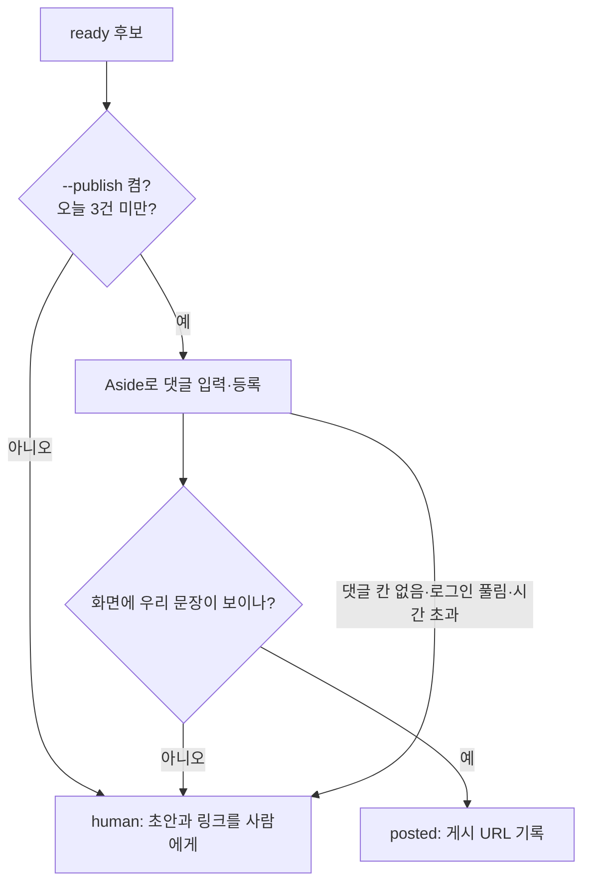

# GTM Agent 구조

찾기 → 매칭 → 초안 → 점수 → 게시 또는 사람 대기열 → 측정. 표준 라이브러리만 쓴다.

## 모듈

| 파일 | 역할 |
|---|---|
| `agent/config.py` | 비밀값 읽기. 환경 변수 → 리블 `.env`(`REEVL_ENV`) 순서로 요청한 이름 하나만 꺼낸다 |
| `agent/reevl.py` | 리블 공개 MCP API 클라이언트(인증 없음, 읽기 전용): 단지 검색·단지 정보·매매 실거래(해제 신고 제외) |
| `agent/links.py` | 리블 기존 딥링크 규격(`/share/compare?compare=…`, `/complex/…`)에 바깥 링크용 UTM을 붙인다 |
| `agent/hubs.py` | 리블 공개 사이트맵에서 학교·역·시공사·지역 허브 이름을 읽어, 글에 그대로 나온 것만 허브 링크로 잇는다 |
| `agent/match.py` | 글 → 단지 찾기. 구·동 맥락이 없으면 이름이 정확히 같은 단지가 한 곳일 때만 고른다 |
| `agent/draft.py` | 같은 전용면적대(±3㎡) 실거래로 비교 근거를 만든다. 거래일·금액·층·표본 수·기준일·한계 |
| `agent/reply.py` | 게시글 한 개 → 관계 공개 + 근거 + 링크 최대 2개 + 면책 문장의 답글 초안 |
| `agent/discover.py` | 네이버 검색 API(카페글·지식iN), 카카오 다음 검색 API로 최근 질문 후보를 찾는다 |
| `agent/queue.py` | 후보 큐(`data/queue.csv`), 점수, 중복 제거, 상태 기록 |
| `agent/poster.py` | Aside 브라우저로 네이버 카페 댓글 게시. 등록 후 되읽어 확인, 실패하면 사람에게 |
| `agent/pipeline.py` | 위를 한 번에 돌리는 `run`. 하루 상한·규칙 allowlist·게시 스위치를 여기서 지킨다 |

## 점수

| 항목 | 범위 | 기준 |
|---|---|---|
| 질문 적합도 (fit) | 0–3 | 글이 단지·학교·역을 특정하고, 리블 페이지가 그 질문에 직접 답하는가 |
| 비교 데이터 (data) | 0–3 | 같은 면적대 실거래가 양쪽에 있는가, 표본이 충분한가 |
| 최신성 (fresh) | 0–2 | 최근 24–72시간 글인가(최신순 상위) |
| 채널 규칙 (rule) | 0–2 | `data/rules.json`에 그 카페·게시판의 허용 확인(공지 URL·확인일)이 있는가 |

**합계 8점 이상이고 rule이 2점일 때만 게시 대상이다.** 점수가 높아도 규칙이 확인되지 않으면 사람 대기열에도 '링크 없는 답변 권장'으로 남긴다.

## 큐 필드

`candidate_id, channel, source_url, found_at, intent, rule_url, rule_checked_at, allowed, score, response_owner, evidence_url, placement_id, posted_url, status, removal_reason`

- 상태: `ready`(게시 대상) → `posted` / `human`(사람이 게시) / `skip`(규칙·점수 미달) / `removed`(삭제·신고, 채널 중단 사유 기록)
- 질문 원문·작성자 닉네임은 저장하지 않는다. 공개 URL과 최소 메모만 둔다.
- 큐 파일은 저장소에 올리지 않는다(`data/`는 `.gitignore`).

## 실패 → 사람

- 등록 버튼을 누른 뒤의 실패는 재시도하지 않는다(중복 게시 방지). 사람이 확인한다.
- 지식iN 답변은 편집기 구조가 달라 v0에서는 사람 게시다.

## 검색 소스

| 소스 | 쓰나 | 이유 |
|---|---|---|
| 네이버 검색 API (카페글·지식iN·블로그) | 씀 | 공식, 무료 한도 하루 25,000회. 리블 유입의 주 무대 |
| 카카오 다음 검색 API (카페·웹문서·블로그) | 씀 | 공식, REST 키. 다음 카페·웹문서를 덮는다. 한도는 카카오 콘솔 쿼터에서 확인 |
| Google Custom Search JSON API | 안 씀 | 신규 가입이 막혔고 2027-01-01 종료 예정 |
| Brave Search API | 안 씀 | 결제 카드 등록이 필요하고 무료 범위가 크레딧제로 바뀜(무료만 쓰는 원칙) |
| 커뮤니티 직접 수집(로그인 세션 크롤링) | 안 씀 | 약관·접근권한 위반 위험 |

## 하지 않는 것

자동 대량 댓글, 계정 여러 개 돌리기, 가입·등급 제한 우회, CAPTCHA 우회, 자작 질문·후기 사칭, 쪽지·DM 발송, 같은 문구 반복 게시.
